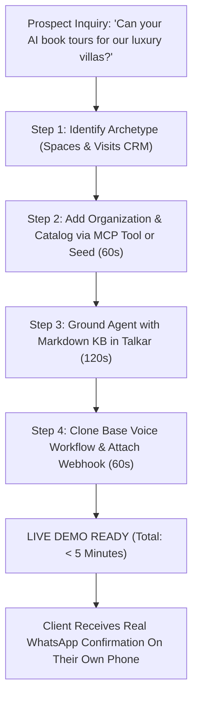

# The Universal CRM Architecture & "No-Mehnat" Onboarding Playbook
*How Talkar Delivers High-Touch Enterprise AI Demos in Under 5 Minutes with Zero Waste, Zero Code, and Protected Agency Margins*

---

## 1. Executive Summary & The Business Reality

### 1.1 The Agency / Tech SME Trap: "The Demo Graveyard"
In the B2B AI Voice Agent and Enterprise software market, prospective SME clients typically request:
> *"Can you show me this working specifically for my boutique coworking space / luxury villa project / aesthetic dental clinic / banquet lawn before we sign the retainer?"*

When agencies respond by building custom software for each prospective client:
1. **Engineering Hours Burned:** A developer spends 30–50 hours setting up a new database schema, creating custom REST APIs, configuring specialized n8n workflows, designing new WhatsApp templates, and creating a branded dashboard.
2. **Client Ghosting:** In the SME/mid-market sector, 60–70% of prospective clients ghost, delay procurement decisions by 3 months, or reduce their scope after seeing the demo.
3. **The Margin Destruction:** An SME retainer in India ranges from ₹25,000 to ₹75,000 per month. If you burn ₹60,000 in engineering labor on a prospect who never closes, **you need two paying clients just to break even on the failed pitch**.

### 1.2 The "No-Mehnat" Golden Rule
> **"Never write a single line of backend code, never create a new SQL migration, and never register a brand-new WhatsApp template for a client who hasn't paid an onboarding advance."**

Every prospective client in the world fits into one of **4 Universal Archetypes**. Once these 4 archetypes are running in production Docker containers with their corresponding n8n gateways and Meta WhatsApp templates, any new client in any industry can be onboarded in **under 5 minutes** purely by injecting data into existing structures.

Even if the prospect ghosts:
- **Zero Loss:** No engineering debt was accumulated.
- **Reusable Asset:** The assets generated (grounding KB, prompt patterns) expand our internal library for that vertical forever.

---

## 2. The 4 Universal CRM Archetypes (The 80/20 Rule)

99% of all commercial businesses require one of four core operational engines. Talkar covers all of them on dedicated subdomains:

```
                               ┌─────────────────────────────────────────────────────────────┐
                               │                 TALKAR UNIVERSAL CRM SUITE                  │
                               └──────────────────────────────┬──────────────────────────────┘
                                                              │
         ┌────────────────────────────┬───────────────────────┴───────────────────┬───────────────────────────┐
         ▼                            ▼                                           ▼                           ▼
┌──────────────────┐        ┌──────────────────┐                        ┌──────────────────┐        ┌──────────────────┐
│   1. SALES CRM   │        │  2. HOTEL PMS    │                        │  3. CLINIC EMR   │        │  4. SPACES CRM   │
├──────────────────┤        ├──────────────────┤                        ├──────────────────┤        ├──────────────────┤
│ Port: 7576       │        │ Port: 7575       │                        │ Port: 7577       │        │ Port: 7578       │
│ salescrm.        │        │ hotelpms.        │                        │ clinic.          │        │ spaces.          │
│ talkar.in        │        │ talkar.in        │                        │ talkar.in        │        │ talkar.in        │
├──────────────────┤        ├──────────────────┤                        ├──────────────────┤        ├──────────────────┤
│ Archetype:       │        │ Archetype:       │                        │ Archetype:       │        │ Archetype:       │
│ Lead Qualification│       │ Multi-Room /     │                        │ Doctor Slot /    │        │ Asset Booking +  │
│ & B2B Discovery  │        │ Nightly Inventory│                        │ OPD Consultation │        │ Tour / Site Visit│
├──────────────────┤        ├──────────────────┤                        ├──────────────────┤        ├──────────────────┤
│ Best For:        │        │ Best For:        │                        │ Best For:        │        │ Best For:        │
│ • B2B SaaS       │        │ • Boutique Hotels│                        │ • Dental Clinics │        │ • Coworking      │
│ • Agencies / IT  │        │ • Resorts & Inns │                        │ • Dermatologists │        │ • Real Estate    │
│ • Consulting     │        │ • Homestays / B&B│                        │ • Physio Centers │        │ • Banquets / Lawns│
│ • Financial Svcs │        │ • Serviced Apts  │                        │ • Specialist OPDs│        │ • Sports Turfs   │
└──────────────────┘        └──────────────────┘                        └──────────────────┘        └──────────────────┘
```

### Archetype Breakdown & Capabilities

| CRM Archetype | Subdomain & Port | Primary Interaction Pattern | Dual-Track Capabilities | Fallback WhatsApp Template |
| :--- | :--- | :--- | :--- | :--- |
| **Sales CRM** | `salescrm.talkar.in` (7576) | BANT Qualification, Pitching, Demo Scheduling | Discovery $\rightarrow$ Meeting Scheduled | `sales_appointment_confirmed` |
| **Hotel PMS** | `hotelpms.talkar.in` (7575) | Check-in/Check-out, Room Type, Nights, GST | Room Inventory $\rightarrow$ Direct Booking | `hotel_booking_confirmed` |
| **Clinic EMR** | `clinic.talkar.in` (7577) | Symptoms, Doctor Selection, Date/Time Slot | Medical Triage $\rightarrow$ OPD Appointment | `sales_appointment_confirmed` / `clinic_appointment_confirmed` |
| **Spaces CRM** | `spaces.talkar.in` (7578) | Flexible Resource Booking + Physical Site Tour | **Track A:** Direct Booking<br>**Track B:** Tour / Site Visit | `spaces_visit_confirmed` (APPROVED)<br>`spaces_booking_confirmed` |

---

## 3. The Anatomy of Universal Data: Why No Schema Changes Are Ever Needed

The secret to zero-mehnat onboarding is having **Polymorphic Data Models** at the database layer.

### 3.1 The Universal Spaces & Visits Schema Pattern
In `talkar-spaces-crm`, an `Asset` can be anything with a capacity, duration, and price:
```prisma
model Asset {
  id           String        @id @default(uuid())
  locationId   String
  location     Location      @relation(fields: [locationId], references: [id])
  name         String        // "Hot Desk", "3BHK Villa", "Grand Ballroom", "Court A"
  type         String        // DESK, CABIN, MEETING_ROOM, RESIDENTIAL, VENUE, TURF
  capacity     Int           // Pax / Seats / Square footage
  pricePerDay  Float?
  pricePerHour Float?
  priceMonthly Float?
  amenities    String?       // Stored as JSON string
  isActive     Boolean       @default(true)
}
```

### 3.2 Polymorphic JSON Metadata (`customFields`)
Every `Lead`, `Booking`, and `SiteVisit` has a JSON field:
- A Coworking lead stores: `{"teamSize": 8, "moveInDate": "2026-12-01", "parkingSlots": 2}`
- A Real Estate lead stores: `{"bhkType": "3BHK", "budgetCr": 2.5, "possession": "Ready"}`
- A Banquet lead stores: `{"guestCount": 450, "eventType": "Reception", "catering": "Veg"}`
- A Sports Turf lead stores: `{"sport": "Box Cricket", "shoeRental": true, "lighting": true}`

**The database does not care.** The UI simply renders whatever JSON keys are present in an aesthetic key-value table. **Zero DB migrations.**

---

## 4. The 5-Minute "No-Mehnat" Onboarding Blueprint

When a brand-new prospect contacts us wanting a tailored demonstration:



### Step 1: Add Organization & Catalog (60 Seconds)
Use the Spaces CRM REST API or Seed script:
```bash
curl -X POST https://spaces.talkar.in/api/v1/spaces \
  -H "Content-Type: application/json" \
  -d '{
    "locationId": "loc_prestige_whitefield",
    "name": "4BHK Presidential Sky Villa (East Tower)",
    "type": "RESIDENTIAL",
    "capacity": 8,
    "priceMonthly": 350000,
    "amenities": ["Private Infinity Pool", "Smart Home Automation", "Italian Marble"]
  }'
```

### Step 2: Ground the Agent with Markdown Knowledge Base (120 Seconds)
Create a clean markdown file specifying the pricing, location, parking policies, and booking terms:
- Go to Talkar MCP / UI $\rightarrow$ Knowledge Base.
- Upload `prestige_villas_grounding.md`.
- No code required; Sarvam 105B or Gemini 2.5 uses this text directly for reasoning and grounding.

### Step 3: Clone Base Voice Agent Workflow (60 Seconds)
- Duplicate Talkar Base Agent (e.g., Workflow `127` - "Elite Co-Works Advisor").
- Update the system prompt with the client's business name and host name (e.g., "Prestige Estates").
- The pre-built universal tools (`spaces_check_availability`, `spaces_book_site_visit`, `spaces_hold_slot`) remain unchanged.

### Step 4: Dial & Close (Immediate)
Dial the prospect's number. When the conversation finishes:
1. The call record appears instantly on `https://spaces.talkar.in` with audio playback and full transcript.
2. The site visit or booking appears on the dashboard board.
3. The prospect's mobile phone rings with an official WhatsApp confirmation message.

---

## 5. Universal WhatsApp Gateway Strategy: Avoiding Meta's Review Bottleneck

### 5.1 Why Custom Templates Per Client Is Fatal
Meta's Cloud API review process takes anywhere from 30 minutes to 24 hours. If you submit a template called `prestige_villa_visit_confirmed`, you cannot demo it immediately.

### 5.2 The Universal Dynamic Template Architecture
We use **Universal Semantic Templates** that pass the company name, customer name, date, time, and reference as dynamic parameters:

#### Template A: `spaces_visit_confirmed` (APPROVED ✅ - ID: 4700747286820192)
```
Header: Site Visit Confirmed - {{1}}
Body:
Hello {{1}},
Your site visit at {{2}} is confirmed! 🎉
📋 Reference: {{3}}
📅 Date: {{4}} at {{5}}
📍 Centre: {{6}}
👤 Host: {{7}}
We look forward to showing you around!
```
- For Coworking: `{{2}} = "Elite Co-Works"`, `{{6}} = "BTM Centre"`, `{{7}} = "Vikram"`
- For Real Estate: `{{2}} = "Prestige Estates"`, `{{6}} = "Sky Villas Clubhouse"`, `{{7}} = "Ananya"`
- For Banquets: `{{2}} = "Royal Palm Lawns"`, `{{6}} = "Main Hall"`, `{{7}} = "Chef Rajesh"`

#### Template B: Fallback Strategy
If any newly submitted template is in `PENDING` state:
- The n8n router automatically falls back to `sales_appointment_confirmed` (APPROVED ✅).
- The patient or client still gets an instant official WhatsApp message with full details without any error.

---

## 6. The Multi-Industry Universal Matrix

| Industry Vertical | Recommended Engine | Track A (Immediate Booking) | Track B (Physical Tour / Visit) | What Changes Per Client? |
| :--- | :--- | :--- | :--- | :--- |
| **Coworking Spaces** | `spaces.talkar.in` | Day Pass / Meeting Room / Desk | Centre Tour with Community Lead | Just KB text + Inventory JSON |
| **Real Estate Brokerage** | `spaces.talkar.in` | Token Advance / Unit Hold | Sample Apartment / Villa Site Visit | Just KB text + Inventory JSON |
| **Banquets & Lawns** | `spaces.talkar.in` | Date Hold / Reception Slot | Venue Walkthrough & Menu Tasting | Just KB text + Inventory JSON |
| **Sports Turfs & Arenas** | `spaces.talkar.in` | Court Slot (Cricket/Football/Padel)| Membership Consultation | Just KB text + Inventory JSON |
| **Auto Dealerships** | `spaces.talkar.in` | Booking Deposit | Test Drive Appointment | Just KB text + Inventory JSON |
| **Dental / Aesthetic Clinics** | `clinic.talkar.in` | Instant Consultation Payment | Doctor In-Clinic OPD Consultation | Just KB text + Doctor Schedule JSON |
| **Luxury Boutique Hotels** | `hotelpms.talkar.in` | Room & Suite Direct Reservation | Property Walkthrough (Destination Weddings) | Just KB text + Room Tariff JSON |
| **B2B Agencies & SaaS** | `salescrm.talkar.in` | Contract Sign-off | Discovery Call / Demo Session | Just KB text + BANT Criteria JSON |

---

## 7. Operational Checklist: When A New Demo Client Arrives

When sales or management introduces a new demo client, follow this exact checklist:

1. [ ] **Classify the Vertical:** Does the client sell inventory by the night (`Hotel`), consultation by the doctor (`Clinic`), meetings by the hour/space (`Spaces`), or B2B contracts (`Sales`)?
2. [ ] **Select Existing Subdomain:** Use `spaces.talkar.in`, `hotelpms.talkar.in`, `clinic.talkar.in`, or `salescrm.talkar.in`.
3. [ ] **Seed Catalog:** Insert their locations and offerings via REST API or seed script (5 minutes).
4. [ ] **Draft 1-Page Markdown Grounding:** Capture address, pricing, parking, and operational hours.
5. [ ] **Duplicate Voice Agent in Talkar:** Attach the corresponding MCP tools (`spaces_check_availability`, `spaces_book_site_visit`, etc.).
6. [ ] **Run Live Test Call:** Verify call audio, real-time board update, and WhatsApp delivery on a team phone.
7. [ ] **Deliver Demo:** Show the client their live branded board at `https://[engine].talkar.in/?orgId=[client_id]`.
8. [ ] **If Client Ghosts:** Do nothing. The infrastructure costs zero marginal dollars and the reusable assets stay in your library.

---
*Created by Talkar Architecture Team. No rights reserved for internal deployment.*
